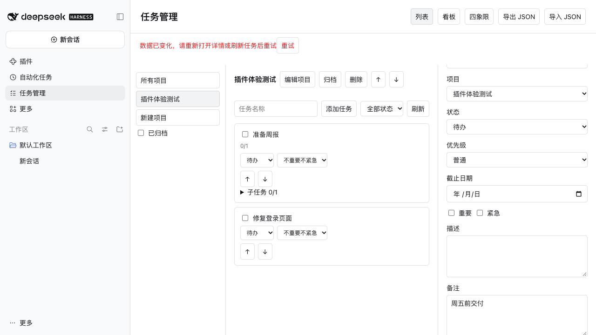
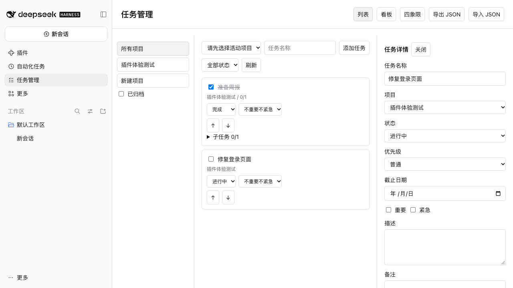
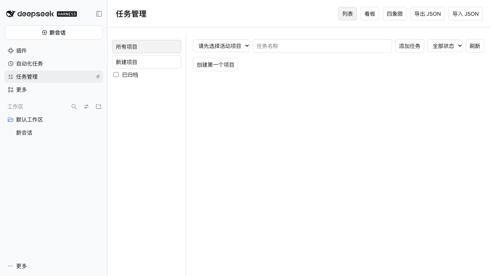
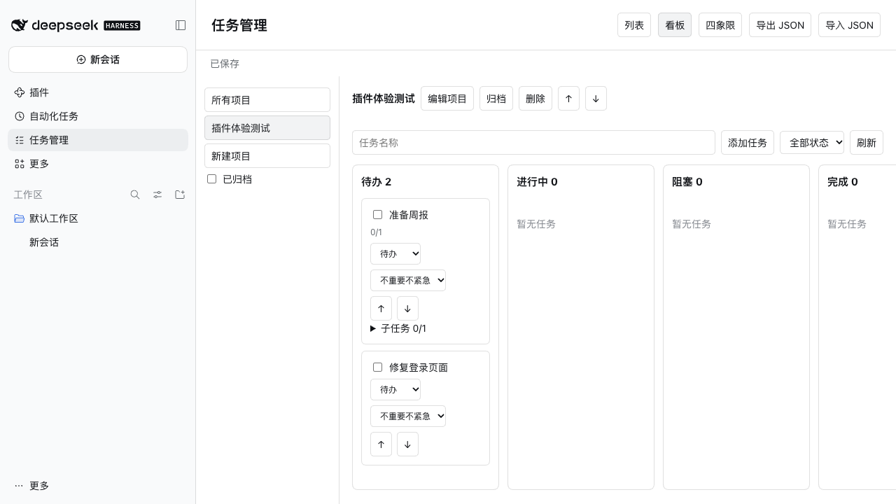
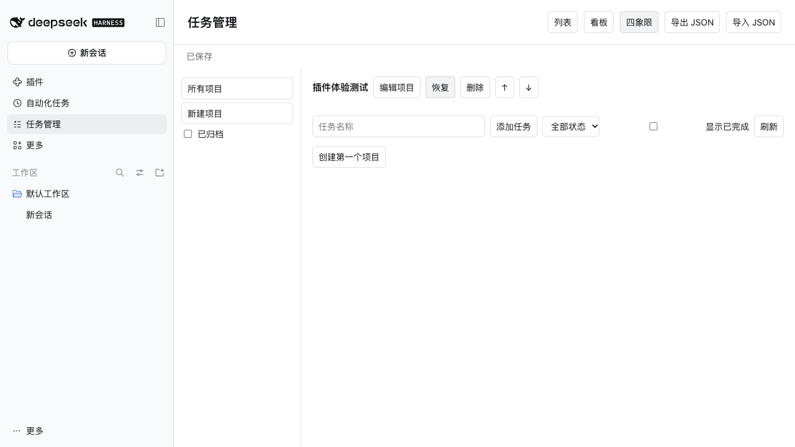

# Task Manager 真实界面试用报告

2026-11-14，macOS，Node 24.15.0，已安装桌面应用附带的 DSH 0.2.2-rc.2，Chrome，1280×720。插件 0.1.0。使用官方 CLI 安装到独立临时 DSH_HOME；未读写用户日常任务数据。未修改插件实现。

结论：基础功能可用，但不适合直接作为稳定日用版本。发现两个涉及编辑可靠性的高优先级问题，以及三个明确的交互问题。本轮为小数据量探索性 UI 测试，不是完整 V-001～V-030 验收，不替代原验证报告。

## 已通过的检查

- `npm run check`：通过。
- `npm test`：22/22 通过。
- 使用上述 DSH CLI 执行 `npm run test:host`：安装、认证 API、停用/启用、重启持久化通过。
- 真实界面：创建项目、创建两个主任务、创建子任务、重新打开详情后普通保存备注、列表/看板/四象限切换、拖拽至进行中、完成主任务、归档/恢复均执行成功。
- 拖拽后 Host 快照中「修复登录页面」为 doing；「准备周报」完成后从默认四象限隐藏。
- 真实下载 JSON，再经文件输入上传、预览、确认合并成功。预览 0 新项目、0 新主任务、0 新子任务、4 跳过；合并后仍为 1 项目、3 任务实体。
- 浏览器控制台未记录错误或警告。

## P1：添加子任务使尚未保存的父任务草稿无法保存

复现：

1. 打开父任务详情，在「备注」输入内容，暂不保存。
2. 在同一详情下添加子任务，等待成功。
3. 点击父任务「保存」。
4. 出现「数据已变化，请重新打开详情或刷新任务后重试」。
5. 点击「重试」，再保存，仍出现相同错误。

实际 Host 快照：子任务已保存，父任务备注仍为空；备注只留在输入框。关闭并重新打开后可以正常保存，但必须放弃或手工复制草稿。

原因定位：`client.js:251` 的 change 在 detailDirty=true 时不推进 detailRevision；子任务创建推进全局 revision，`client.js:563` 又用旧 revision 保存父任务。`client.js:1267` 的 refresh 只更新模型，不解决草稿 revision。

建议：区分同窗口已知变更与外部冲突；对不同任务的已知变更安全更新草稿基线。对外部冲突保留草稿，并提供可操作的重新载入/合并流程。

## P1：切换宿主面板会静默丢失草稿

复现：

1. 打开任务详情，在备注输入「切换页面前尚未保存的备注」。
2. 点击 DSH 左侧「插件」，再点击「任务管理」。
3. 详情关闭，视图重置为列表，项目范围重置为所有项目。
4. 重新打开任务，备注为空；离开时没有确认提示。

原因定位：`client.js:208` 的 Page 使用本地 React 状态和未受控表单；`client.js:310` 的草稿确认只覆盖 open()，未覆盖宿主面板切换。草稿没有跨挂载保存。

建议：将草稿提升至插件模型并按任务 ID 保留；接入宿主允许的离开确认机制。可另行保留项目、视图与筛选偏好。

## P2：新建项目后仍需重复选项目

空白状态仍展示可编辑任务名称和可点击「添加任务」。新建第一个项目成功后，停留在「所有项目」，项目下拉仍为空。直接添加任务出现「请先选择活动项目」。

原因定位：`client.js:785` 创建成功只关闭弹窗，没有选择新项目；`client.js:1101` 又依赖独立的 createProject 或 scope。

建议：创建成功后直接进入新项目；没有活动项目时让创建项目成为明确的主操作。

## P2：常见窗口宽度下看板第四列被截断

1280×720、宿主侧栏展开、未打开任务详情时，内容容器 clientWidth=795，scrollWidth=894，完成列超出可视区域，需要横向滚动。任务卡片把状态、象限、上移、下移长期展开，两张短标题任务已占较多纵向空间。这是可用性问题，不代表数据丢失。

原因定位：`client.js:160` CSS 固定项目侧栏 205px，看板四列各至少 210px；断点基于整个窗口宽度，未考虑宿主侧栏占用。

建议：按插件容器宽度响应布局，提供收起项目栏入口；减少卡片常驻操作，将次要操作移至详情或菜单。

## P2：归档唯一项目后出现误导性空状态

归档唯一活动项目后，项目从侧栏消失，但顶部仍是该项目及「恢复/删除」操作；内容显示「创建第一个项目」，侧栏没有选中的项目。项目实际仍存在，归档筛选打开后可以找到并恢复。

原因定位：`client.js:1058` 附近归档动作不调整 scope；`client.js:1173` 只用筛选后的 projects.length 判断「第一个项目」提示。

建议：归档后切换到所有活动项目，明确显示「暂无活动项目」，并提供查看归档项目入口。

## 测试边界

本轮未验证大数据量浏览器性能、完整键盘路径、深色主题、实际断网、双窗口并发与异常磁盘故障。SP 兼容只由现有核心样本测试覆盖，未在 UI 中导入 SP 文件。以上未测项不计为通过。

优先顺序：先处理草稿丢失与本窗口冲突，再改善首次创建流程、看板空间和归档空状态。
